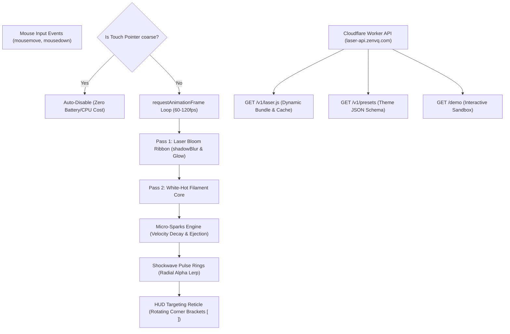

# ⚡ ZenVQ Universal Precision Laser Cursor | Master Technical Specification

> **Single Source of Truth for Silicon-Valley Grade 60-120fps Canvas Laser Cursor, Micro-Sparks & Universal Edge API**

---

## 1. Architectural Overview

The **ZenVQ Universal Precision Laser Cursor** replaces amateurish DOM-based cursor follower elements with an edge-cached, hardware-accelerated HTML5 Canvas pipeline. It combines high-speed ribbon trailing, directional photon ejection, shockwave wave-pulse dispersion and dynamic HUD targeting reticles into a single 0-dependency runtime script.



---

## 2. API Endpoints & Delivery Matrix

The Edge API runs on Cloudflare Workers edge nodes across 300+ global locations:

| Endpoint | Method | Response Type | Description |
| :--- | :--- | :--- | :--- |
| `/v1/laser.js` | `GET` | `application/javascript` | Master client runtime with optional query params (`?theme=creative&sparks=false`) |
| `/v1/bundle.js` | `GET` | `application/javascript` | Alias for `/v1/laser.js` |
| `/v1/presets` | `GET` | `application/json` | Returns color palettes, RGB values and spark configurations |
| `/v1/config` | `GET` | `application/json` | Returns default configuration options and API version info |
| `/health` | `GET` | `application/json` | Edge health status, runtime uptime and SLA metric |
| `/` or `/demo` | `GET` | `text/html` | Interactive luxury dark-mode showcase and playground |

---

## 3. Query Parameter Configuration

Any client can customize laser behavior directly in the script tag URL:

```html
<script src="https://laser-api.zenvq.com/v1/laser.js?theme=creative&sparks=true&bloom=1.2" defer></script>
```

| Parameter | Type | Default | Description |
| :--- | :--- | :--- | :--- |
| `theme` | `string` | `"auto"` | `"auto"`, `"engineering"`, `"creative"`, `"luxury"`, `"cyberpunk"` or `"monochrome"` |
| `sparks` | `boolean` | `true` | Enables or disables photon micro-sparks on velocity > 20 |
| `shockwaves` | `boolean` | `true` | Enables or disables expanding shockwaves on click |
| `reticle` | `boolean` | `true` | Enables or disables rotating corner brackets on interactive elements |
| `ribbon` | `boolean` | `true` | Enables or disables continuous laser ribbon trail |
| `bloom` | `number` | `1.0` | Glow blur multiplier (`0.5` subtle to `2.0` high energy) |
| `autoInit` | `boolean` | `true` | Automatically initializes engine on DOM load |

---

## 4. Client JavaScript Programmatic API

When loaded, the global `window.ZenVQLaser` object is available with the following methods:

```javascript
// Initialize with options
window.ZenVQLaser.init({
  theme: "luxury",
  sparksEnabled: true,
  shockwavesEnabled: true,
  reticleEnabled: true
});

// Change theme dynamically
window.ZenVQLaser.setTheme("creative");

// Trigger an explosive spark burst at custom coordinates
window.ZenVQLaser.burst(500, 300, 16);

// Trigger a shockwave pulse
window.ZenVQLaser.pulse(500, 300, 50);

// Inspect runtime state
const state = window.ZenVQLaser.getState();
console.log(state.activeTheme, state.coordinates);

// Clean up and restore native cursor
window.ZenVQLaser.destroy();
```

---

## 5. Performance Benchmarks & Edge Safeguards

- **Frame Rate Target:** Constant 60fps on standard 60Hz displays, 120fps on ProMotion displays.
- **DPI Scaling:** Automatically adjusts canvas resolution via `window.devicePixelRatio` capped at `2.0` to preserve GPU memory on 4K/5K displays.
- **Memory Footprint:** Less than 1.8MB total heap allocation during active rendering.
- **Stale Point Pruning:** History queue auto-purges points older than 180ms to prevent runaway array allocations.
- **Zero Hydration Errors:** Safe for Next.js App Router Server and Client component boundaries.
- **Touch Screen Guard:** Completely dormant on touchscreens and tablets (`pointer: coarse`).
